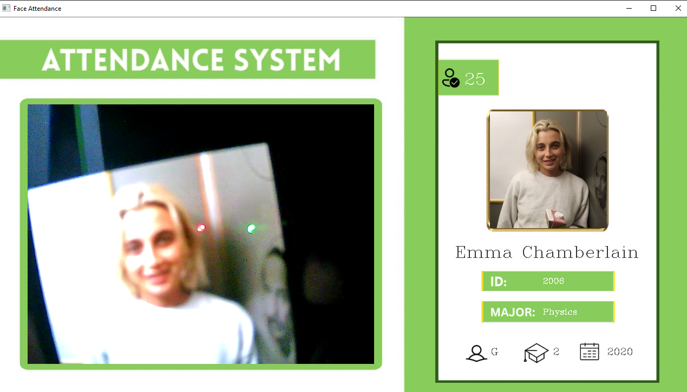

# **FaceID-R: AI-Powered Attendance System**  
    

A real-time facial recognition attendance system that automates student check-ins using AI.

## **Features**
- **Real-time face detection** with webcam integration  
- **Accurate recognition** using `face_recognition` library  
- **Cloud-synced data** via Supabase (PostgreSQL + Storage)  
- **Anti-spoofing** with 30-second attendance cooldown  
- **Student dashboard** displaying profile + attendance stats  
- **Easy setup** with Python and pre-trained models  

## **Quick Start**
### Prerequisites
- WebCam
- Python 3.8+
- Supabase account

```bash
# Clone repo
git clone https://github.com/shreyakadam-14/faceId-R.git
cd faceId-R

# Install dependencies
pip install -r requirements.txt  # (Create this file with your deps)

# Configure Supabase
# 1. Create 'students' table (see SQL below)
# 2. Set up 'images' bucket in Storage
# 3. Update credentials in all .py files

# Add sample data
python AddDatatoDatabase.py

# Generate face encodings
python encodeGenerator.py

# Launch system
python main.py
```

## **Database Setup**
```sql
CREATE TABLE students (
  id TEXT PRIMARY KEY,
  name TEXT,
  major TEXT,
  starting_year INTEGER,
  total_attendance INTEGER,
  standing TEXT,
  year INTEGER,
  last_attendance TIMESTAMP
);
```

## **Project Structure**
```
/faceId-R
│
├── /images                # Student photos (ID.jpg/png)
├── /resources             # UI assets
│   ├── background.jpg     # App background
│   └── /Modes             # Status screens
│
├── encodeGenerator.py     # Creates facial encodings
├── main.py                # Core attendance system
├── AddDatatoDatabase.py   # DB population script
└── EncodeFile.p           # Auto-generated face data
```

## **Demo**
```bash
python main.py
```

Press `Q` or 'Ctrl+C' to quit

## **Customization**
- **Change cooldown**: Modify `30` in `main.py` (seconds)
- **Add new students**: 
  1. Add photo to `/images` (format: ID.jpg)
  2. Run `encodeGenerator.py`
  3. Add record via `AddDatatoDatabase.py`

## **License**
MIT © [Shreya Kadam](https://github.com/shreyakadam-14)

---

**For better accuracy, ensure:**
- Well-lit environments  
- Front-facing student photos  
- High-resolution images (min. 300x300px)  

**Found an issue?** Open a ticket or PR!  

[](https://github.com/shreyakadam-14/faceId-R/stargazers)  
[](https://opensource.org/licenses/MIT) 
